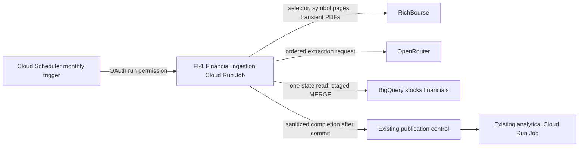

# Gate 2 - Architecture Design

**Status:** FINAL
**Version:** 1.0
**Date:** 2026-11-01
**Input reference:** FI-1 — RichBourse annual-financial ingestion redesign
**Author:** Software Architect Agent

## 1. Executive Summary

FI-1 replaces the financials-specific Cloud Functions, Workflow, and archive path with one monthly private Cloud Run Job. The job discovers the RichBourse selector once, visits each selected company page serially in selector order, and processes the newest five available annual statements. It skips already-ingested `(symbol, fiscal_year)` records unless the advertised document link has changed. PDFs, extracted text, prompts, and model responses are transient process memory; `stocks.financials` is the only retained ingestion record. Complete successful symbol results are buffered and written through Terraform-managed staging in batches of at most ten terminal symbols, then emit one sanitized completion only after every current-run batch commits. OpenRouter extraction attempts the approved models in order: `gemma-4-31b-it`, `nvidia/nemotron-3.5-lightning:free`, then `openai/gpt-4o-mini`. The job retains the existing completion-driven Long-Term publication mechanism and introduces no user-facing workflow.

## 2. Business Context & Drivers

The V1 Long-Term workflow needs consistent annual financial inputs without maintaining a fragile chain of financial Cloud Functions, Workflow steps, PDF archives, or extraction artifacts. RichBourse is the source of company announcements and statement PDFs; OpenRouter extracts the approved financial fields; BigQuery is the canonical retained store. The monthly job must cover the current selector population (48 companies) while avoiding unnecessary provider calls and writes. Portfolio tracking, trading, new scoring rules, source-PDF retention, extraction evidence retention, and financial restatement detection at an unchanged URL are out of scope.

## 3. Requirements Traceability

| Req ID | Requirement | Design decision | Component(s) | Reused/New |
|---|---|---|---|---|
| FI-01 | Collect each selector company’s newest five available annual reports. | Fetch selector once; fetch each symbol page serially in selector order; reject interim reports; choose five newest annual fiscal years. | RichBourse adapter; Cloud Run Job | Reused/New |
| FI-02 | Do not re-extract an unchanged annual statement. | Read existing state once and skip a matching `(symbol, fiscal_year, document_link)`; changed links replace the row for the same `(symbol, fiscal_year)`. | BigQuery writer; Cloud Run Job | Reused/New |
| FI-03 | Persist the six approved nullable numeric fields. | Enforce exact JSON keys, finite numbers or nulls, and source-year agreement before write. | OpenRouter client; validation | Reused/New |
| FI-04 | Use the approved ordered model fallback. | Attempt `gemma-4-31b-it`, then `nvidia/nemotron-3.5-lightning:free`, then `openai/gpt-4o-mini`, once each. | OpenRouter client | Reused |
| FI-05 | Retain no PDF or extraction evidence. | Keep source and provider material only in memory; logs retain only bounded operational counters/classes. | Cloud Run Job; observability | New/Reused |
| FI-06 | Run monthly with minimal orchestration. | Cloud Scheduler invokes one private Cloud Run Job; no financial Workflow, Pub/Sub, Tasks, or archive bucket path. | Scheduler trigger; Cloud Run Job | Reused/New |
| FI-07 | Preserve Terraform table ownership and safe publication. | Terraform owns job, IAM, schedule, secret reference and BigQuery tables; staged `MERGE` precedes the completion event. | Terraform; BigQuery writer; completion adapter | Reused |
| NFR-01 | Bound current-scope processing. | One active execution, serial RichBourse access, one attempt per model/report, ten-terminal-symbol write batches, timeout no greater than 60 minutes. | Cloud Run Job | New |
| NFR-02 | Make retries safe. | `symbol, fiscal_year` is the storage uniqueness key; unchanged links are no-ops and changed links update that key atomically. | BigQuery writer | Reused |
| NFR-03 | Keep secrets and source content out of durable telemetry. | Inject `OPENROUTER_API_KEY` at runtime from Secret Manager; never log or persist source/provider payloads. | Terraform; Cloud Run Job | Reused/New |
| NFR-04 | Preserve V1 delivery controls. | Build a commit-addressed immutable image, deploy it unchanged to development, verify, then promote the same digest through human approval. | Delivery workflow; Terraform | Reused |

## 4. Architecture Overview

The source context is RichBourse; OpenRouter is an external extraction backing service; BigQuery owns durable financial rows; the existing completion-control path requests Long-Term publication after a successful changed import. The financial job is a private, stateless batch container; Cloud Scheduler is its only trigger.



## 5. Component Design

### 5.1 Financial ingestion Cloud Run Job

- **Purpose:** Execute one bounded monthly batch from discovery through committed financial rows and completion notification.
- **New:** The existing function/workflow chain cannot provide the requested single-process, in-memory-only flow; one job removes those boundaries.
- **Interfaces/data:** Reads runtime configuration and a Secret Manager-provided key; consumes RichBourse pages/PDF bytes; writes only validated staging rows and `stocks.financials`; emits one sanitized completion outcome after commit.
- **Technology:** Cloud Run Job, using the existing Python ingestion modules and managed BigQuery writer patterns.

### 5.2 RichBourse annual-statement adapter

- **Purpose:** Parse the selector and symbol-filtered pages, identify annual statement links, and reject quarterly/half-year activity reports.
- **Reused:** Extend the existing `functions/financials/scrape_financials.py` RichBourse parsing/transport seam rather than create a second scraper.
- **Interfaces/data:** Returns symbol, fiscal year, announcement metadata, and absolute document link; it does not persist a PDF.
- **Technology:** Existing curl-cffi/BeautifulSoup approach with bounded retries and one request at a time.

### 5.3 OpenRouter extraction and validation

- **Purpose:** Convert transient statement content into the fixed six-field JSON contract.
- **Reused:** Consolidate existing extraction behavior in the financial modules; no new provider abstraction is required.
- **Interfaces/data:** Input is a transient PDF/text representation plus expected fiscal year. Output must contain exactly `fiscal_year`, `revenue`, `net_income`, `total_debt`, `cash_and_cash_equivalents`, and `total_equity`, where every value is a finite number or null.
- **Technology:** Existing OpenRouter HTTP client and runtime secret injection. A fallback occurs only after a provider failure, invalid JSON/schema, year conflict, or result with no usable financial value.

### 5.4 Financials state and staged writer

- **Purpose:** Read current row/link state once and commit all changed valid rows atomically enough for retry-safe processing.
- **Reused:** Keep the Terraform-managed BigQuery table and run-scoped staging/`MERGE` pattern; runtime code does not create or replace tables.
- **Interfaces/data:** Storage identity is `symbol, fiscal_year`. `document_link` is a mutable source-reference attribute: a different link for the same identity permits replacement; a matching link is skipped.
- **Technology:** BigQuery parameterized state query, staging table and `MERGE` after each ten terminal symbols and after the final partial batch.

### 5.5 Completion and publication adapter

- **Purpose:** Notify the existing publication control only when changed financial rows have committed.
- **Reused:** Use the existing typed, sanitized managed-import completion contract.
- **Interfaces/data:** Emits source identity/outcome metadata only; no PDF, extracted text, prompt, response, or secret is included.
- **Technology:** Existing completion-control integration.

The contract boundary consumed by the runtime wave is `functions.financials.fi1_contracts`: `parse_selector_symbols(html)`, `richbourse_symbol_page_url(symbol)`, `parse_annual_candidates(html, symbol, limit=5)`, `is_approved_document_url(url)`, `validate_extraction(payload, source_fiscal_year=...)`, and `decide_row_state(existing_document_link=..., candidate_document_link=..., extraction_succeeded=...)`. It exposes `AnnualCandidate(symbol, fiscal_year, document_link, announcement_title)`, `ValidatedExtraction` with exactly the six FI-1 extraction fields, and `RowDecision` (`insert`, `skip`, `replace`, `preserve`). Candidate document URLs and every redirect target must remain on the HTTPS origin `https://www.richbourse.com`; runtime fetchers stop at the first off-origin redirect. These functions are offline and pure: they have no source/provider clients, storage writers, or telemetry hooks; source PDFs/text and provider prompts/responses/evidence stay outside the contract objects.

### 5.6 Cloud Scheduler trigger

- **Purpose:** Start the private job once per month and distinguish trigger delivery failure from job execution failure.
- **Reused:** Configure the existing Terraform Scheduler pattern for direct Cloud Run Job invocation.
- **Interfaces/data:** OAuth/OIDC invocation permission only; schedule activation remains an operational approval.
- **Technology:** Cloud Scheduler and least-privilege invoker IAM.

### 5.7 Terraform delivery and retirement configuration

- **Purpose:** Declare the job, schedule, identity, secret reference, IAM, table references, and a controlled retirement path for the obsolete financial topology.
- **Reused:** Extend the repository’s Terraform modules and 12-factor delivery controls; no runtime resource creation is allowed.
- **Interfaces/data:** Receives non-secret environment configuration; exposes Terraform-managed resources only. Existing archive objects and historical revision assets are not deleted in FI-1.
- **Technology:** Terraform, Secret Manager metadata/reference, and the existing immutable-image release path.

## 6. Reuse Inventory

| Existing asset | Used for | Why it fits |
|---|---|---|
| `functions/financials/scrape_financials.py` | RichBourse transport and annual-report discovery seam | Already handles symbol pages, fiscal-year extraction, interim-report rejection, and transport failures. |
| `functions/financials/insert_financials.py` | PDF text/extraction and financial normalization seam | Already contains provider, extraction, and normalization behavior to consolidate. |
| `tests/ingestion/financial_pipeline/` | Offline regression coverage | Existing test location owns financial pipeline fixtures and behavior. |
| Terraform BigQuery staging/MERGE resources | Financial row write | Satisfies the Terraform-managed-table policy and current 12-factor amendment. |
| Dedicated financial runtime identity/OpenRouter secret metadata | Runtime credentials | Delivers secret-specific access without putting payloads in source or Terraform state. |
| Managed import completion/publication control | Post-commit analytical refresh | Preserves the existing Long-Term correction-publication path. |
| Container build/release workflow | Job image delivery | Supports commit-addressed immutable image promotion across environments. |

## 7. Data Architecture

`stocks.financials` remains the canonical financial ingestion table and is Terraform-managed. Its logical row identity is `(symbol, fiscal_year)`; the source `document_link` is retained only as a mutable lookup/reference field. The job issues one read of existing `(symbol, fiscal_year, document_link)` state before processing. A matching link is skipped; a changed link may update the same identity after validation; a failed candidate leaves an existing row unchanged or an absent row absent. A symbol contributes rows to the write buffer only when all of its selected non-skipped reports succeed; a failed eligible report discards that symbol’s newly derived rows. Each non-empty batch uses a distinct staging run identifier and updates in-memory counters/state only after its managed-write receipt is validated.

The validated payload persists the six requested nullable numeric fields. Null denotes unavailable information, never zero. Validation requires the exact key set, numeric finiteness, and a fiscal year matching the page/source metadata. PDFs, PDF-derived text, prompt content, and OpenRouter responses are never written to GCS, BigQuery, Firestore, logs, artifacts, or tests. They are released with process memory at the end of extraction. FI-1 deliberately cannot detect an in-place source change at an unchanged URL and cannot replay an extraction from retained evidence.

## 8. Interfaces & Integrations

| Integration | Direction | Contract |
|---|---|---|
| RichBourse | Job → source | Fetch selector once; request `?symbole=<symbol>` pages; accept annual-report links only; transient PDF download. |
| OpenRouter | Job → provider | Runtime `OPENROUTER_API_KEY`; exactly one bounded attempt per approved model; strict JSON response contract. |
| BigQuery | Job ↔ `stocks.financials` | One state read, run-scoped staging load and `MERGE` per non-empty ten-terminal-symbol batch; logical key `(symbol, fiscal_year)`. |
| Completion control | Job → existing control | Sanitized successful completion only after the BigQuery commit; no completion for failed/no-op work unless the existing contract explicitly represents no-op success. |
| Cloud Scheduler | Scheduler → Job | Monthly private invocation using least-privilege job-run permission. |
| Secret Manager | Job ← secret | Runtime-only OpenRouter credential reference; no payload in Terraform, code, logs, or tests. |

## 9. Cross-Cutting Concerns

**Security.** The financial job uses the dedicated financial runtime identity and resource-level OpenRouter secret accessor grant. Scheduler receives only the Cloud Run Job invocation permission. Runtime configuration and secrets are injected, never baked into the image.

**Observability.** Emit bounded counts for discovered, annual candidates, skipped, inserted, updated, failed and model attempts, plus sanitized transport/provider error classes. In development only, per-candidate diagnostics use the fixed selection/skip/PDF/text/provider/terminal schema with the candidate symbol, fiscal year, source announcement title, approved RichBourse document link, duration, model, and sanitized error class. Do not emit source/PDF content, prompts, responses, credentials, or user data; production emits no per-candidate diagnostics.

**Resilience and scale.** Permit one active execution, serial RichBourse requests, one model attempt per configured model/report, finite provider/transport retries, ten-terminal-symbol commit boundaries, and a maximum 60-minute execution. An all-model failure makes its symbol ineligible for the current write buffer and is retried next month; earlier committed batches remain durable if a later source or writer failure stops the run. A source or writer failure must not produce a completion event.

**Deployment.** The job image is built from the merged `development` commit, identified by digest, and deployed unchanged to development. Development verification measures the 60-minute bound and validates no durable source/evidence artifacts. Promotion uses that same digest through a human-approved production gate. Rollback restores the prior job image/schedule configuration; it does not delete canonical BigQuery rows.

**12-factor alignment.** The repository remains the one codebase; dependencies are locked in the image; config/backing services are injected; the job is stateless and disposable; stdout logs are sanitized; and recovery/manual execution uses the same image and environment-specific configuration.

## 10. Alternatives Considered & Trade-offs

| Option | Pros | Cons | Decision | Driver |
|---|---|---|---|---|
| Retain financial Cloud Functions + Workflow | Reuses deployed topology | Multiple boundaries, archive behavior, and difficult end-to-end state | Reject | FI-06 simplicity |
| Direct Cloud Run Job | One bounded process and direct lifecycle | Requires a job image and scheduler/IAM migration | Accept | FI-01, FI-05, FI-06 |
| Archive PDFs/extraction evidence | Replay/audit support | Contradicts explicit retention decision and adds storage/handling | Reject | FI-05 |
| Treat `document_link` as part of row identity | Preserves link revisions | Creates duplicate annual observations | Reject | NFR-02; owner confirmed `(symbol, fiscal_year)` |
| Re-extract every report monthly | Detects some provider variance | Unnecessary provider cost and source load | Reject | FI-02 |
| Add queues/topics/tasks | More asynchronous control points | Unneeded platform machinery for one monthly bounded batch | Reject | FI-06 |

## 11. Assumptions

1. RichBourse continues to expose the selector and `?symbole=<symbol>` filtering for the current 48-company scope; implementation validates this with offline fixtures and a separately approved development run. **Owner:** implementation wave.
2. The existing `stocks.financials` schema can retain `document_link` while using `(symbol, fiscal_year)` as its logical uniqueness key; any Terraform schema adjustment is backward-compatible. **Owner:** BigQuery/Terraform wave.
3. Existing completion control accepts a changed-financial import outcome from the new job without a source-specific workflow invocation; the event adapter is verified against the merged control contract. **Owner:** integration wave.
4. The configured `gemma-4-31b-it` identifier is the approved OpenRouter primary model; availability/rate-limit errors fall through to the next configured model. **Owner:** operations configuration wave.

## 12. Risks & Mitigations

| Risk | Impact | Likelihood | Mitigation |
|---|---|---|---|
| RichBourse markup or access behavior changes | Missing or failed collection | Medium | Fixture-based parser tests, bounded retries, sanitized transport metrics, monthly retry. |
| Provider/model result is invalid | Missing annual row or unnecessary fallback | Medium | Exact-schema validation, source-year check, ordered one-attempt fallback, null preservation. |
| Same URL serves a replacement statement | Undetected stale result | Low/Medium | Accepted retention trade-off; source-link changes trigger replacement, otherwise next architecture decision must add source versioning. |
| Migration leaves an old scheduler/workflow active | Duplicate charges/writes | Medium | Explicit Terraform retirement inventory, schedule deactivation verification, and a single-active-trigger acceptance test. |
| One monthly job exceeds its time bound | Incomplete run | Low/Medium | Four-request concurrency cap, bounded attempts, development timing test, configurable timeout/concurrency. |
| No retained extraction evidence | Cannot replay or audit a row | Certain | Owner-approved BigQuery-only retention; operational investigation uses sanitized counters only. |

## 13. Notes for the Orchestrator

| Wave | Work item | Depends on | Complexity |
|---|---|---|---|
| 1 | Freeze FI-1 contracts: parser fixtures, strict payload validator, row identity/replacement and no-persistence tests. | None | M |
| 2 | Implement the single job code path using the frozen contracts and existing writer/completion seams. | Wave 1 | L |
| 3 | Terraform the Cloud Run Job, direct monthly Scheduler, minimal IAM/secret binding, and non-destructive legacy retirement controls. | Wave 1; existing credential prerequisites where still unmerged | L |
| 4 | Integrate job packaging, job/writer/completion behavior and infrastructure configuration; retire function/workflow invocation. | Waves 2–3 | L |
| 5 | Run offline end-to-end coverage, delivery/observability checks, current-head CI and development verification. | Wave 4 | M |

Wave 1 owns `functions/financials/` contracts and `tests/ingestion/financial_pipeline/`. Wave 2 owns the new job module and focused tests. Wave 3 owns Terraform function/workflow/scheduler/IAM variables and infrastructure tests. Wave 4 consumes both contract and infrastructure outputs and is serialized because it changes packaging and retirement bindings. Existing credential issues #344/#347 are not duplicated; the orchestrator must verify their merged artifacts on `development`, or retain them as explicit hard prerequisites before job secret wiring. Existing narrowly scoped transport/observability issues #342/#352 remain separate unless their delivered behavior is folded into a reviewed FI-1 implementation branch.

No cloud plan/apply, secret-value provisioning, paid provider call, paid BigQuery query, schedule activation, production mutation, or deployment is authorized by this design alone. Each implementation issue requires an isolated worktree from current `development`, one reviewed PR, current-head CI, and evidence of merged predecessor artifacts. Do not delete historical GCS objects or annual financial revision assets during this migration; that requires a separate data-retention decision.

## 14. Machine-Readable Handoff

```yaml
status: READY_FOR_ORCHESTRATION
open_questions: 0
assumptions_count: 4
components:
  - name: Financial ingestion Cloud Run Job
    kind: new
  - name: RichBourse annual-statement adapter
    kind: reused
  - name: OpenRouter extraction and validation
    kind: reused
  - name: Financials state and staged writer
    kind: reused
  - name: Completion and publication adapter
    kind: reused
  - name: Cloud Scheduler trigger
    kind: reused
  - name: Terraform delivery and retirement configuration
    kind: reused
new_components: [Financial ingestion Cloud Run Job]
reused_components:
  - RichBourse annual-statement adapter
  - OpenRouter extraction and validation
  - Financials state and staged writer
  - Completion and publication adapter
  - Cloud Scheduler trigger
  - Terraform delivery and retirement configuration
blocking_risks: []
```
