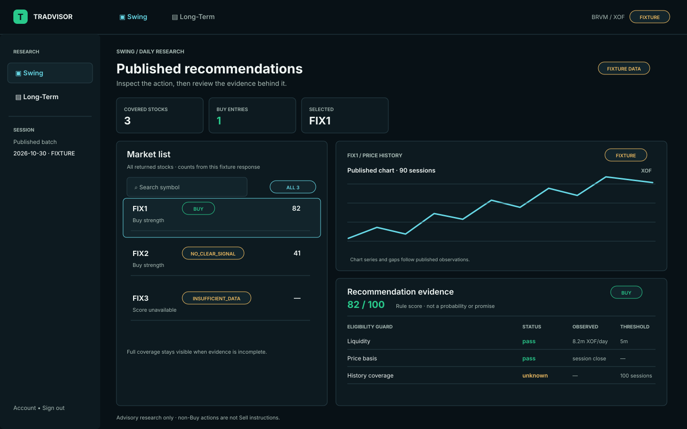
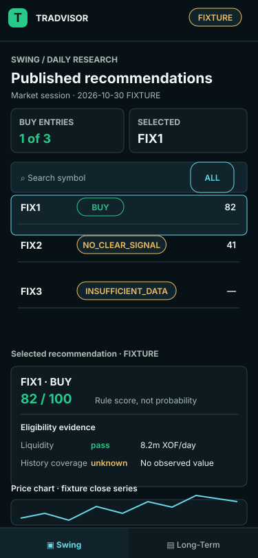
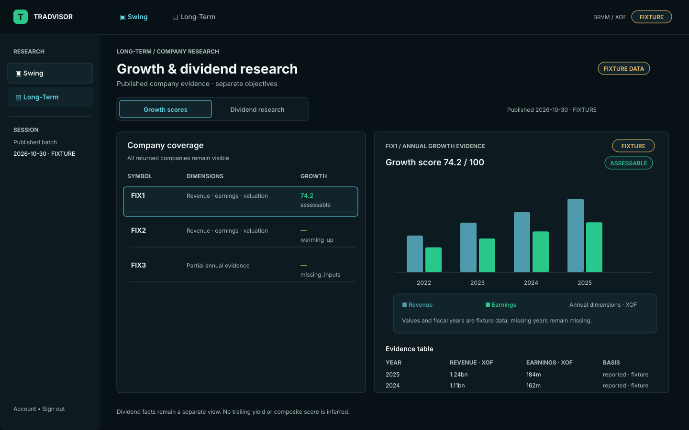
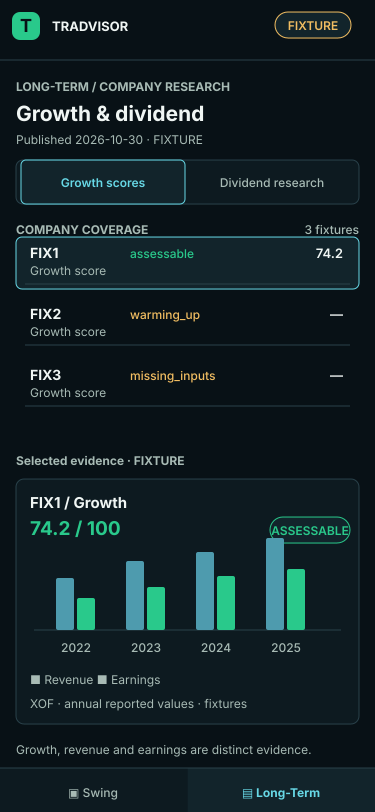
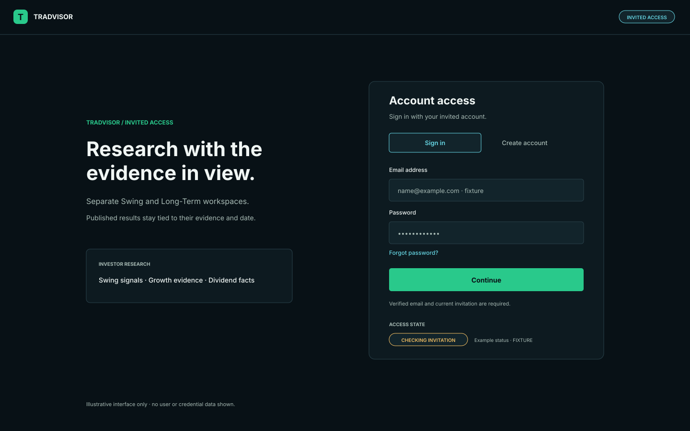
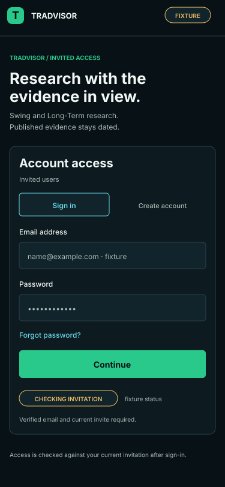

# Recommendation-first terminal — design proposal

**Status: proposed, awaiting owner visual validation.** This document and the boards below satisfy the #388 review pass; they do not authorize implementation. Record explicit owner acceptance on issue #388 before #389 starts.

## Direction

A compact research terminal for experienced BRVM investors. Recommendations lead each workspace; the selected company and its dated supporting evidence stay visible beside them. Swing and Long-Term remain equally prominent in global navigation. The product is read-only research: no holdings, orders, broker actions, live prices, or suitability claims.

The screen boards are wire-level visual compositions. Every value and count shown on them is synthetic fixture data, identified with a `FIXTURE` marker; none is a current BRVM result.

| Screen | Desktop · 1440 px | Mobile · 375 px |
|---|---|---|
| Swing |  |  |
| Long-Term |  |  |
| Authentication |  |  |

## Routes and interaction flow

- `/swing/`: show published recommendations for the full returned stock set, derived Buy count and active batch date. Search/filter or select a stock; selection updates its chart and evidence. Keep all non-Buy rows, using the API action labels `no_clear_signal` and `insufficient_data`; never call them “Watch” or “Sell”. The strength is a rule score, not probability.
- `/long-term/`: keep Growth scores and Dividend research as separate, equal tabs. Selecting a company updates annual Growth dimensions or dividend payment facts. Dividend evidence shows its actual coverage and payment rows; it does not imply a trailing yield or Dividend/Balanced composite score. A Balanced compatibility field remains deferred and is not a user-facing workflow.
- `/sign-in/`: sign in is the primary state, with create-account and password-reset paths. After authentication, show invitation checking, verification, denied/expired access, or admitted workspace selection from the existing session state. Do not expose protected research until admitted.
- Global navigation links Swing and Long-Term directly and marks the current route. On narrow screens it becomes a fixed two-item bottom bar with labels and icons; keyboard focus and active state remain visible.

## Visual tokens — proposed for owner review

| Token | Proposed value | Use |
|---|---|---|
| `canvas` | `#081116` | page background |
| `surface` | `#0D1A20` | panels and header |
| `surface-raised` | `#12242B` | selected rows, inputs |
| `line` | `#29414A` | dividers and outlines |
| `ink` | `#F0F6F4` | primary text |
| `muted` | `#A8BBB5` | secondary text |
| `positive` | `#29C98B` | Buy/pass only, always paired with text |
| `caution` | `#F2BE62` | unavailable, caveat and unknown evidence |
| `failure` | `#F26D75` | errors and failed guards |
| `selection` | `#67D8E6` | focus and selected navigation/row |

Text pairs above exceed WCAG AA 4.5:1 against the three proposed surfaces. Status must remain legible without color. Use a 4 px spacing base, 44 px minimum interactive targets, 16 px body text, 12 px minimum metadata, and tabular numerals for scores and money. Evaluate IBM Plex Sans/Mono with local/system fallbacks before selecting or bundling fonts. No external font fetch is assumed.

## Responsive behavior

- At 1200 px and wider, use a 216 px workspace rail and a two-column research area: full-coverage list at roughly 38%, selected-company evidence at roughly 62%. Keep the recommendation, company selection and evidence in the first viewport.
- At 768–1199 px, collapse the rail to a top workspace switcher and stack evidence beneath the list; retain the selection summary at the top of the detail area.
- At 375 px, use a compact header and bottom Swing/Long-Term navigation. Summary cards wrap to two columns; rows become a one-column list with symbol, API action and score. The selected detail follows the list. Search, tabs and row selection remain tap targets of at least 44 px. No horizontal page scrolling.
- Do not require drag resizing or hover. Preserve browser zoom and support reduced motion; transitions are brief state cues only.

## Data and state presentation

| State | Presentation |
|---|---|
| Loading | Stable panel skeletons plus a textual `Loading published research` status; keep navigation usable. |
| Empty | Explain that no publication or matching rows exist; distinguish empty API data from a search with zero matches. |
| Swing no-Buy | Show the full returned list and a derived `0 Buy` summary; preserve actual `no_clear_signal` / `insufficient_data` actions. |
| Missing / warming-up / deferred | Show the API status and reason next to the affected metric. Do not fabricate a value or suppress the company. |
| Chart-only unavailable | Keep the recommendation and evidence visible; mark only the chart unavailable with its own explanation. |
| Publication unavailable | Show a workspace-level unavailable message and retry affordance only when the API marks the failure retryable; never imply freshness. |
| Denied / expired session | Explain access status, offer the existing sign-in path, and do not render protected data. |
| Error | Place a concise message at the failed panel; retain unrelated loaded content. Do not display raw API error details. |
| Guard evidence | Use the returned guard `status`, `observed`, `threshold`, and evidence references. Omit absent observed values rather than inventing them. |
| Counts and date | Derive counts from the returned `items` array. Use response `market_session`, `published_at`, and batch metadata; label their meaning. |

Use exactly the generated contract enums: Swing `entry_action` is `buy`, `no_clear_signal`, or `insufficient_data`; guard status is `pass`, `fail`, or `unknown`. Long-Term metric state uses the published status (`assessable`, `warming_up`, `missing_inputs`, `unsupported_basis`, or `deferred_scope`). Chart errors stay chart-local when recommendations loaded. Fixture screens intentionally show `no_clear_signal`, `pass`, `unknown`, and `warming_up`; they illustrate layout only.

## Component and file ownership for implementation wave

#389 owns global theme tokens, typography decision, root layout/navigation and shared components. Later tickets own feature-local composition: #390 Swing recommendation list/selection, #391 Long-Term evidence/tabs, #392 auth states, #393 Swing chart/evidence integration, #394 integrated accessibility/workflow verification. Proposed CSS ownership is global tokens in `frontend/src/app/globals.css`, then scoped styles in each feature directory; no feature should add global selectors. Do not change generated schemas or backend contracts for these designs.

## Accessibility review targets

Semantic headings and tables; announced loading/error/status updates; clear visible focus; active workspace via `aria-current`; selected tabs via `aria-selected`; action/status labels in text; accessible chart summary plus a data table; logical list-to-evidence focus order; no color-only distinction. Validate keyboard-only and screen-reader flows for auth, Swing selection, Long-Term tabs and mobile navigation in #394.

## Decision record

Owner choice is pending. Confirm or revise the route hierarchy, responsive arrangement, token values, density and IBM Plex/system-font direction on #388. After explicit validation, update this document to `owner-validated`, record the decision/date, and finalize component ownership before #389 begins.
