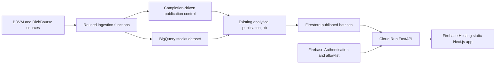
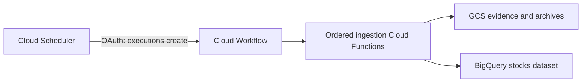

# Tradvisor V1 Architecture

**Status:** Active V1 architecture

**Engineering amendment:** TF-1, approved 2026-10-12 and incorporated 2026-10-14. R1–R7 define the target design; implementation and compliance verification remain pending.

## Scope

Tradvisor V1 is a read-only BRVM research application with two equal workflows:

- **Swing:** daily technical entry research for the listed equity universe.
- **Long-Term:** Growth ranking, company evidence, and dividend facts where the source coverage supports them.

The product publishes research, explanations, and evidence. It does not maintain portfolios, accept orders, execute transactions, track cash or positions, or connect to a broker.

## System Design

## Approved Direct Scheduler-to-Workflow Amendment

The owner approved direct Cloud Scheduler invocation of Cloud Workflows on
2026-10-20. Each managed Scheduler job creates an execution of its named
ingestion workflow through the Workflows Executions API using the existing
least-privilege service identity. Scheduler acceptance confirms that an
execution was created; Workflow execution state remains the authoritative
completion and failure signal.

This is the target architecture amendment, not a claim about the currently
deployed state. The deployed state remains unchanged until the reviewed
implementation, CI, Terraform plan, development proof, and separate
operational approvals are complete.

Cloud Tasks queues and the internal Cloud Run workflow-dispatcher are not part
of the target scheduled-ingestion path. Their retirement is an implementation
task, subject to dependency verification and the normal reviewed Terraform
delivery process. Existing ingestion workflow definitions, schedules, GCS and
BigQuery contracts, and completion-driven publication control remain unchanged.

Operational monitoring must distinguish a Scheduler delivery failure from a
Workflow execution failure. Before retiring queue-based serialization, the
implementation must verify that each workflow's maximum execution duration is
within its next scheduled interval and that existing ingestion idempotency
handles any permitted retry or overlap.

The static Next.js application uses authenticated client requests to the Cloud Run API. The API verifies Firebase identity, verified email, and the current allowlist before returning published analytical data. The browser never accesses BigQuery or writes Firestore directly.

## Data Flow

### Cloud-only ingestion amendment

The approved [v1.1 cloud-only ingestion amendment](https://github.com/issacamara/tradvisor/issues/1#issuecomment-6110931290) supersedes future V1 requirements for a separate share-price revision store and point-in-time share-correction replay. Completed #14 and #42 remain historical delivery records; this amendment does not delete or reclassify their delivered work.

1. Existing ingestion functions retain incoming files and raw source evidence in GCS, then load company, share, dividend, financial, and rating data into the configured environment's Terraform-managed `stocks` dataset. Canonical `shares` observations are keyed by symbol and date; corrections may update that row while retaining the history needed for charts and indicator warm-up. V1 does not persist a separate share-price revision store or provide point-in-time replay of share corrections.
2. A successful import emits a sanitized completion outcome only after its managed BigQuery write has finished. The reused ingestion workflow/control plane coalesces eligible outcomes and then starts the existing analytical Cloud Run Job. It is completion-driven, not a second fixed-time analytical schedule.
3. `shares` is the daily publication dependency and starts a refresh after a successful daily import. `financials` starts a refresh after a successful import because it changes Long-Term inputs. `ratings` is retained as an ingestion dataset but neither gates nor starts publication in V1 because the current analytical reader does not consume it. Adding ratings later requires an approved analytical-contract amendment.
4. The control plane serializes publication requests and uses a bounded, release-configured debounce window. Multiple eligible completions in that window produce at most one job execution. Before starting a run, it compares the source-input identity with the active publication; an unchanged input set is recorded as a no-op rather than producing a duplicate publication.
5. The existing analytical job reads only the necessary partitioned BigQuery history, calculates indicators and Long-Term inputs, and writes an immutable publication batch.
6. The job validates the candidate batch and atomically updates `publication_state/current` only after all required serving documents are present.
7. Firestore serves compact, read-optimized publication documents. BigQuery remains the analytical source of truth and is never queried by an interactive request.
8. The API reads the active publication, returns typed availability states for missing or warming inputs, and exposes chart observations for the selected symbol.

## Components

| Component | Responsibility |
|---|---|
| Ingestion | Reuse the BRVM/RichBourse collection functions; retain incoming/raw source evidence in GCS plus source metadata, session date, and ingestion outcome. |
| Publication control | Extend the existing ingestion Workflow/dispatcher and serialized task-control pattern to accept successful input-completion outcomes, coalesce them, reject duplicate source snapshots, and invoke the existing analytical job. It does not calculate analytics or serve user requests. |
| BigQuery | Store canonical source tables, including dated `shares` rows keyed by symbol/date, and partitioned analytical inputs. |
| Analysis job | The single existing Cloud Run Job calculates EMA20/EMA50, RSI14, ATR14, traded-value liquidity, Swing entry state/strength, and Long-Term Growth research after an eligible input completion. |
| Firestore | Store immutable analytical batches and one active-publication pointer only. |
| Cloud Run API | Authenticate requests and expose read-only analytical resources. |
| Firebase Hosting | Deliver the static frontend. |
| Firebase Authentication | Authenticate users; the API additionally enforces verified-email and allowlist admission. |

## Analytical Rules

Swing uses EMA 20/50, Wilder RSI 14, Wilder ATR 14, and a 20-session traded-value liquidity window. A Buy requires an unrounded strength of at least 70, median traded value of at least 5,000,000 XOF, trading in at least 18 of the latest 20 exchange sessions, and all published structural guards. A result that cannot be established is explicitly `insufficient_data`; it is never inferred as Buy or Sell.

Long-Term V1 publishes Growth scores when required financial inputs are available. Dividend payments and conditional historical yield remain research facts; Dividend and Balanced composite scores are deferred. Every result identifies its batch, effective date, rule version, calculation status, and evidence references.

## Firestore Serving Model

| Document path | Responsibility |
|---|---|
| `analysis_batches/{batch_id}` | Batch manifest, source snapshot, rule version, session date, and publication timestamp. |
| `analysis_batches/{batch_id}/swing/{symbol}` | Swing entry state, strength, eligibility guards, and indicator evidence. |
| `analysis_batches/{batch_id}/long_term/{symbol}` | Growth score, advisory state, factor contributions, and evidence. |
| `analysis_batches/{batch_id}/charts/{symbol}` | Bounded dated close-price observations used by the frontend chart. |
| `publication_state/current` | Active complete batch identifier and publication metadata. |
| Publication-control state | Sanitized source-input identity, coalescing/request state, and last outcome needed to serialize a retry-safe dispatch. It contains no user data or source payloads. |

These documents are rebuildable analytical serving copies. No user financial state is stored in Firestore.

## API Contract

The read-only API surface is:

| Endpoint | Purpose |
|---|---|
| `GET /v1/me` | Current admitted identity. |
| `GET /v1/swing/recommendations` | Published Swing screening results. |
| `GET /v1/long-term/rankings` | Published Long-Term Growth research. |
| `GET /v1/stocks/{symbol}` | Company and published analytical detail. |
| `GET /v1/stocks/{symbol}/chart` | Bounded close-price observations for a selected stock. |

Responses use the standard `data` and `meta` envelope and include explicit unavailable states. There are no mutation endpoints in V1.

## Deployment and Cost Controls

- Firebase Hosting serves the static frontend.
- Cloud Run API uses zero minimum instances and request-based billing.
- Heavy calculations run once per daily batch, preferably in BigQuery, not on interactive API requests.
- The existing analytical Cloud Run Job is the only recurring analytical compute. Import-completion events may request it, but coalescing and input-snapshot deduplication ensure that one ready input set produces at most one execution.
- BigQuery source and analytical tables use partitioning and only select the necessary symbols, dates, and columns.
- Terraform declares development resources in `dev-tradvisor`; production remains isolated and read-only unless separately approved.
- Deploy through the repository GitHub Actions workflow after a committed, pushed change and passing CI.

## Security and Operations

- Firebase Authentication handles password, verification, and reset flows.
- The API fails closed if identity or allowlist admission cannot be verified.
- The frontend has no service-account credentials and no direct Firestore write capability.
- Published batches are immutable. A failed daily run leaves the most recent complete batch active and visible with its original date.
- A successful daily shares import must have an active publication based on that input within the existing 15-minute publication target; source-to-publication lag is monitored. A failed or stale publication is surfaced as stale/unavailable, never hidden by an interactive BigQuery fallback.
- The completion trigger identity may invoke only the existing analytical job. It has no Firestore read/write privilege beyond the minimal publication-control state and no authority to change schedules, analytical rules, source tables, or user-serving data.
- Logs contain operational metadata only and never carry user secrets or credentials.

## Approved Publication-Orchestration Amendment

The owner approved completion-driven publication on 2026-10-18 to prevent the
published Firestore batch from lagging successful source imports. This
amendment extends existing ingestion orchestration and the existing analytical
Cloud Run Job; it does not introduce a second batch job, a request-time
BigQuery fallback, a new analytical input, or a new user-facing workflow.

This section describes target architecture and does not assert that it is
deployed. Deployment, schedule activation, development proof, and operational
changes remain separately approved delivery steps.

| Decision | Target architecture |
|---|---|
| Trigger | Successful completion of an eligible managed import is the publication trigger; a fixed-time analytical schedule is not the normal path. |
| Dependencies | Shares are required for daily Swing/chart freshness. Financials trigger a Long-Term correction publication when they change. Ratings are not currently a publication dependency. |
| Coalescing | A serialized control-plane extension applies a bounded configurable debounce and source-snapshot deduplication before invoking the job. |
| Failure and retry | Import failure produces no publication request. Job failure preserves the active complete batch, uses the job's finite retry policy, and leaves a bounded sanitized outcome for alerting and recovery. |
| Freshness | Monitor eligible source completion to active-publication lag against the existing 15-minute ready-input target. The UI must distinguish a chart-specific unavailable state from publication-wide unavailability. |
| Recovery | A manual job execution is recovery-only and requires separate owner approval; it does not replace the automated completion trigger. |

Implementation must use Terraform-managed control-plane resources and least-
privilege service identities. Schedule activation, Terraform apply, batch
execution, and any paid query remain separately approved operational actions.

## Retired V1 Surface

The former simulated-trading workflow, its API routes, frontend page, backend modules, Firestore documents, tests, and backlog artefacts are removed from V1. Future product work would require a new approved architecture and contract rather than reusing retired data or code.

## Approved Twelve-Factor Engineering Amendment

The owner approved R1–R7 on 2026-10-12, including complete DuckDB removal. The normative engineering detail, architecture impacts, requirement traceability, acceptance criteria, risks and sequencing are in [Gate 2 engineering amendment TF-1](../../docs/architecture/twelve-factor-amendment.md). It extends existing components without adding platform services or changing financial rules, API scope or V1 workflows.

| Decision | Approved target architecture |
|---|---|
| R1 — Dependencies | Lock complete Python dependency resolutions for backend and ingestion, retain npm locks, explicitly declare imported dependencies, and pin build/deployment tools and container digests. |
| R2 — Configuration | Share validated configuration contracts across API, jobs, ingestion and administration; require explicit environment and backing-service targets; provide secret-free `.env.example` documentation. Keep versioned financial rules distinct from deployment settings. |
| R3 — Backing services | Serve every interactive analytical read, including charts, only from the published Firestore batch; use typed unavailable states instead of BigQuery fallbacks. Terraform owns and protects all application/batch tables, including staging; retain retry identifiers and serialized writers without runtime table creation/replacement. |
| R4 — Build, release, run | Separate artifact build, release preparation and execution. Promote the verified backend image digest, bind artifacts/configuration/rules to a release manifest, and apply the exact approved saved Terraform plan. Build environment-specific static frontend artifacts from the same approved source and locks. |
| R5 — Processes | Remove DuckDB completely: dependencies, imports, local database configuration, persistence paths and DuckDB-specific tests. Use GCS/BigQuery/Firestore for durable state and disposable scratch only; credential-free tests use fixtures/test doubles. No replacement share-revision store or local-revision migration. |
| R6 — Logs | Extend `OperationalEvent` with consistent JSON stdout formatting across entry points, bounded sanitized attributes and safe failure handling; exclude raw provider payloads, credentials and user identifiers. Platform-managed retention remains 30 days. |
| R7 — Admin processes | Wrap existing admission, recovery and maintenance modules with thin commands using the approved backend image/configuration, explicit targets, operation-specific permissions, stable retry identifiers and conspicuous failures. Schema changes remain Terraform-owned. |

These are approved design requirements, not claims that the codebase is now compliant. Implementation must preserve existing resources and source evidence, pass focused checks and current-head review/CI, and obtain separate authorization for cloud plans/applies, migrations, paid queries, seeding, schedule activation or production changes.

Only the engineering amendment is synchronized with `tradvisor_architecture.md`. The pre-existing Swing guard/eligibility wording difference is preserved and requires separate owner reconciliation before any financial-rule change; TF-1 does not choose between those formulations.
