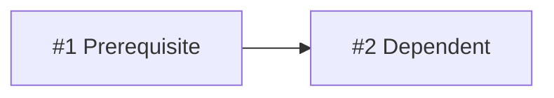

# Epic issue

## Approved scope and sources

[Describe the approved outcome, boundaries and links to exact approved artifact versions or triaged defect context.]

## Child issues

[Link every child issue. Child issue dependency fields and these links are the source of truth.]

## Dependencies

[Maintain this Mermaid flowchart from the child links and dependency fields whenever the backlog changes. Include every child, including independent issues; arrows point from prerequisite to dependent. Replace the example with issue numbers and short outcomes.]

## Completion criteria and evidence

[Record agreed observable criteria and links to evidence, including the development branch PR merge where applicable. Close only after all linked children are complete and all criteria are met.]

## Risks and blockers

[Record remaining blockers and next actions.]
